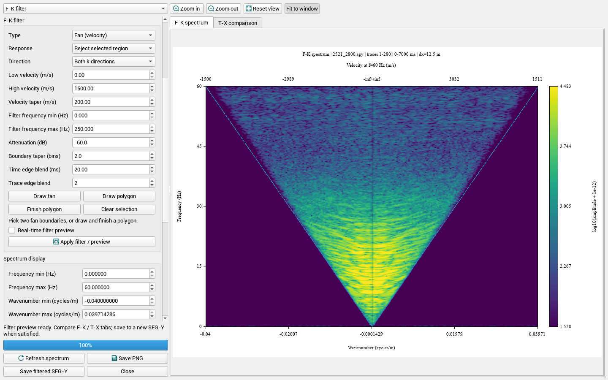
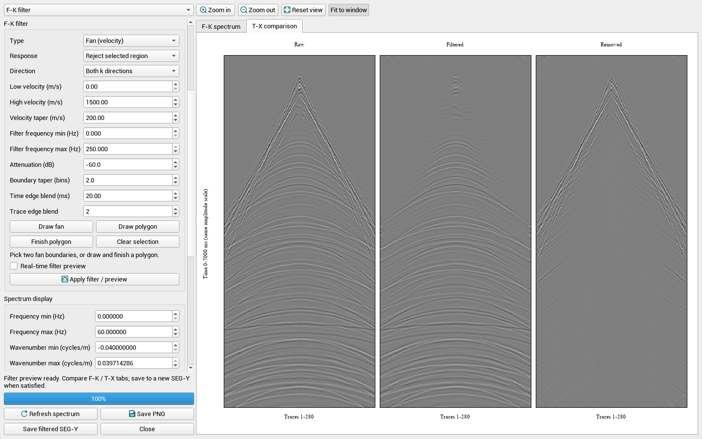

# FK 频谱与滤波

本轮在 Tools → F-K Spectrum 中增加滤波与对比预览。窗口为非模态，主窗口关闭时会取消任务并关闭本窗口。

## 界面

- 左侧集中放置 File、Input range、F-K filter、Spectrum display、Image export 参数；左上分组下拉框可快速跳转。左右面板支持拖动分隔条调整宽度，参数较多时在左侧滚动。
- 控件沿用全局 Roboto 9pt、系统调色板和项目 CustomCheckBox；坐标标注沿用项目 GfxStyle 字体。不再给 FK 参数区单独设置字体颜色或样式表。
- 右侧有 F-K spectrum 和 T-X comparison 两页。时空域图并排显示 Raw、Filtered、Removed，三者共用原始数据的幅度尺度；Removed = Raw − Filtered。
- Zoom in/out、滚轮和左键拖动调整显示范围；Reset view 恢复完整谱坐标。Fit to window 适配预览，不改变 PNG 导出的宽高；极端宽高比时保留最小可读尺寸，仍可滚动查看。
- 顶部速度辅助轴显示 **当前图顶端频率处的 v=f/k**，不是整张图每一行的独立速度坐标；零波数处标为无穷。图中同时显示所选扇形速度边界。

## 扇形滤波

1. 检查输入道范围、时间范围和实际道间距 dx（米）。新开窗口默认使用主窗口当前可见范围。
2. 点击 Refresh spectrum 查看原始频谱。Spectrum display 中的 Remove means + 2-D Hann 只作用于频谱显示，滤波输入使用未经该选项处理的原始采样。
3. F-K filter → Type 选 Fan (velocity)。设置 Low / High velocity，单位 m/s，按 `|v|=f/|k|` 定义扇区；Direction 可选两侧、正 k 或负 k。方向指 FFT 波数符号，不直接等同于地理传播方向。
   也可点击 Draw fan，在谱图上依次单击两条速度边界，程序将它们转换为速度上下限。不要点击零波数线；右键可取消未完成的扇形选择。Direction 仍由左侧参数决定。
4. Response 选 Reject 时衰减选区，选 Pass 时衰减选区外。Attenuation 使用幅度 dB：例如 −60 dB 对应幅度系数 0.001，0 dB 为不衰减。
5. Filter frequency min/max 是实际滤波频带，与 Spectrum display 的显示频率范围分开。Velocity taper 在速度边界外提供余弦过渡，单位 m/s；Boundary taper 在频带边缘提供以 FFT 频率网格为单位的过渡。
6. 点击 Apply filter / preview。用 Preview 下拉框切换原始谱、滤后谱、差值谱或 Filter gain，再到 T-X comparison 查看对应采样数据。

## 多边形滤波

1. 先刷新频谱，点击 Draw polygon。Type 自动切换为 Polygon。
2. 在右侧谱图内依次单击顶点，双击、右击或点击 Finish 闭合。Clear 清空选区；至少 3 个不共线顶点才能计算。
3. 多边形以物理 `(k, f)` 坐标保存，缩放和平移不改变选区。它定义正频率半平面中的区域，负频率部分会按实信号共轭对称关系处理。
4. Reject / Pass、Attenuation 和实际频带设置同扇形。Boundary taper 是按频率／波数网格间距归一化后的边界过渡宽度；多边形模式不使用速度边界参数。
5. 点击 Apply filter / preview。Real-time filter preview 打开后，修改滤波参数或完成多边形会在短暂延迟后刷新预览；未闭合多边形不计算。输入数据范围改变后需要重新刷新或应用滤波。

## 选区边缘和计算约定

- 时间和道范围限定实际处理子窗口；窗口外的原始采样不参与替换。
- 滤波不直接对原数据乘 Hann 窗或做均值删除，避免把显示预处理误当成实际滤波。
- 使用 CWP float FFT 与既有 Bluestein 任意长度路径进行二维变换及反变换。滤波增益按共轭频点配对，DC／Nyquist 别名频点也按对称约束处理，以保证实数输出。
- Time edge blend（ms）和 Trace edge blend（道）控制处理子窗口内部的余弦渐变。实际结果为 `raw + wx*wt*(ifft(mask*fft(raw)) - raw)`，外侧边界渐变回原始数据。设为 0 时不作该方向渐变，较窄窗口会自动限制渐变宽度。
- Filter gain 显示的是边缘混合之前的频域增益（0～1），不是最终滤后／原始谱的逐点比值。
- 当前仍使用原始变换长度，不作额外零填充。显示插值不提高真实频率或波数分辨率。每次子窗口仍限制为 800 万个采样，每轴最多 180180 点。

## 保存

- Save PNG 保存当前 F-K／T-X 页，尺寸严格采用 Image width / height。宽高自动记忆，重新开窗或重启后恢复。
- Save filtered SEG-Y 只在当前参数的滤波预览完成后可用。修改输入或滤波参数后，该按钮失效，需先重新应用滤波。
- 输出包含原文件全部道、全部时间样点，仅替换处理子窗口。保留文本头和道头，二进制头中的采样格式改为 IEEE float32（格式 5），保留原文件字节序。选区外采样保持原值；对于原 IBM／整数格式，文件编码会转换为 IEEE，不能声称逐字节相同。
- 当前仅支持标准定长 SEG-Y 的文件输出，拒绝扩展文本头／尾随数据；SU、CST 可预览，暂不提供滤后文件输出。
- 禁止覆盖源文件。结果通过临时文件原子提交，取消时不留下半成品；源文件被修改后，必须重新滤波才能导出。

## 验证范围

实际数据界面示例（`2521_2800.sgy`，280 道，0～7000 ms，dx=12.5 m 为示例输入；滤波参数仅用于展示预览，不代表推荐处理参数）：

合成波检查覆盖奇偶长度、扇形／多边形、保留／衰减、0 dB 恒等恢复、窗口边缘渐变和取消。SEG-Y 回读检查覆盖采样参数、道头、选区内结果与选区外原值。界面检查覆盖左侧参数归属、字体、缩放、绘制多边形、实时更新、PNG 尺寸及既有 Metrics 功能。

Windows x64 已构建并进行回归检查；Linux、实际多显示器切换及超大数据尚未全面验证。

### 仅查看频谱与隐藏辅助线

选择 Original spectrum，关闭 RealTime，然后使用 Refresh spectrum。默认隐藏滤波边界和零波数参考线；Spectrum display 中的 Show filter boundaries 与 Show zero-wavenumber line 可分别控制显示，均不改变数据或启动滤波。Draw fan / Draw polygon 自动打开边界显示。Save PNG 遵循当前辅助线显示设置。
